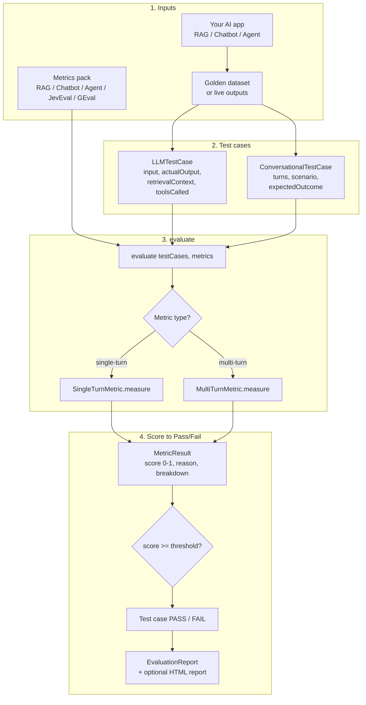
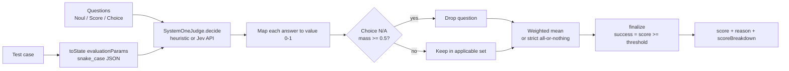
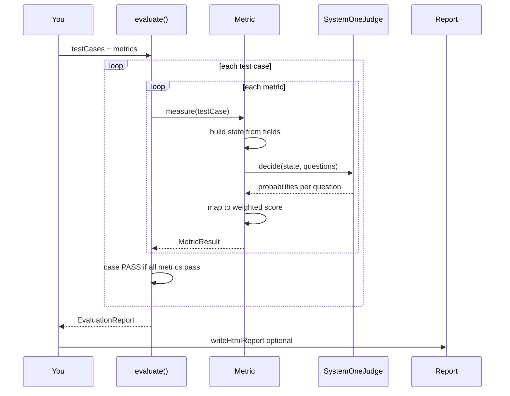

# DeepEVal Framework (TypeScript)

A TypeScript evaluation framework for AI applications — **RAG**, **chatbots**, **agents**, **safety**, and **custom metrics** — inspired by [DeepEval](https://deepeval.com) / [JevEval](https://deepeval.com/docs/metrics-jev-eval).

Scores are `0–1`. A metric passes when `score >= threshold`.

[](https://github.com/Avinash258/DeepEValFramework/actions/workflows/ci.yml)
[](https://github.com/Avinash258/DeepEValFramework/actions/workflows/pages.yml)
[](./LICENSE)
[](https://avinash258.github.io/DeepEValFramework/)

## Install & build

```bash
npm install
npm run build
npm test
```

## CI & evaluation report (GitHub)

| Workflow | What it does |
|----------|----------------|
| `.github/workflows/ci.yml` | On every push/PR: `npm ci` → build → test |
| `.github/workflows/pages.yml` | On push to `main`: generate HTML report → deploy to **GitHub Pages** |

**Live report URL:** https://avinash258.github.io/DeepEValFramework/

### One-time GitHub setup

1. Repo → **Settings** → **Pages**
2. **Source:** GitHub Actions
3. Push to `main` (or run **Actions → Deploy evaluation report → Run workflow**)
4. After the workflow succeeds, open the Pages URL above

## Architecture

```
src/
  test-case/     LLMTestCase, ConversationalTestCase, ToolCall, Turn
  judges/        System-One (heuristic / pluggable) + OpenAI-compatible LLM judge
  metrics/
    jev/         Noul, Score, Choice, JevEval, ConversationalJevEval
    rag/         Answer relevancy, faithfulness, contextual *
    chatbot/     Completeness, retention, role, turn relevancy, topic
    agent/       Task completion, tool correctness / faithfulness, args, efficiency
    safety/      Hallucination, toxicity, bias, PII, prompt alignment
    g-eval.ts    Criteria → LLM-as-judge
    deterministic.ts  JSON / exact match / token F1
  dataset/       Golden + EvaluationDataset
  evaluate.ts    Batch runner + report
```

## How it works

Wrap app outputs as test cases, pick metrics, call `evaluate()`. Each metric builds a JSON **state**, asks a judge questions, maps answers to `0–1`, and passes when `score >= threshold`.

### Framework workflow



### JevEval scoring path

Most built-in metrics are JevEval presets. Flow:



### End-to-end sequence



## Quick start

### 1. Custom JevEval (deterministic question checklist)

```typescript
import {
  JevEval, Noul, Score, Choice, SingleTurnParams,
  LLMTestCase, ToolCall, evaluate,
} from "@deepeval-framework/core";

const toolFaithfulness = new JevEval({
  name: "Tool Faithfulness",
  evaluationParams: [
    SingleTurnParams.INPUT,
    SingleTurnParams.ACTUAL_OUTPUT,
    SingleTurnParams.TOOLS_CALLED,
  ],
  questions: [
    new Noul({
      statement:
        "Every fact and figure in actual_output appears in the output of a tool in tools_called.",
      weight: 2,
    }),
    new Score({
      question: "How much of actual_output is grounded in tools_called?",
      levels: ["Fabricated", "Mostly fabricated", "Mostly grounded", "Fully grounded"],
    }),
    new Choice({
      question: "What did actual_output do with info tools did not return?",
      options: {
        left_it_out: 1.0,
        flagged_it_as_unknown: 1.0,
        hedged_it: 0.5,
        stated_it_as_fact: 0.0,
        nothing_missing: null, // drops the question if N/A
      },
    }),
  ],
});

await evaluate(
  new LLMTestCase({
    input: "Weather in Paris?",
    actualOutput: "18°C and sunny.",
    toolsCalled: [
      new ToolCall({
        name: "get_weather",
        inputParameters: { city: "Paris" },
        output: { temp_c: 18, condition: "sunny" },
      }),
    ],
  }),
  [toolFaithfulness],
);
```

### 2. RAG

```typescript
import {
  evaluate, LLMTestCase,
  AnswerRelevancyMetric, FaithfulnessMetric,
  ContextualRelevancyMetric, ContextualRecallMetric, ContextualPrecisionMetric,
} from "@deepeval-framework/core";

await evaluate(
  new LLMTestCase({
    input: "Where is the Eiffel Tower?",
    actualOutput: "In Paris, France.",
    expectedOutput: "Paris, France",
    retrievalContext: ["The Eiffel Tower is located in Paris, France."],
  }),
  [
    new AnswerRelevancyMetric(),
    new FaithfulnessMetric({ threshold: 0.7 }),
    new ContextualRelevancyMetric(),
    new ContextualRecallMetric(),
    new ContextualPrecisionMetric(),
  ],
);
```

### 3. Chatbot (multi-turn)

```typescript
import {
  evaluate, ConversationalTestCase, Turn,
  ConversationCompletenessMetric, KnowledgeRetentionMetric,
  RoleAdherenceMetric, TurnRelevancyMetric,
} from "@deepeval-framework/core";

await evaluate(
  new ConversationalTestCase({
    scenario: "Customer wants a refund",
    expectedOutcome: "Refund confirmed",
    chatbotRole: "Support agent",
    turns: [
      new Turn({ role: "user", content: "I want a refund on order 4471" }),
      new Turn({ role: "assistant", content: "I can help. Confirming order 4471…" }),
    ],
  }),
  [
    new ConversationCompletenessMetric(),
    new KnowledgeRetentionMetric(),
    new RoleAdherenceMetric(),
    new TurnRelevancyMetric(),
  ],
);
```

### 4. Agents / tools

```typescript
import {
  evaluate, LLMTestCase, ToolCall,
  TaskCompletionMetric, ToolCorrectnessMetric,
  ToolFaithfulnessMetric, ArgumentCorrectnessMetric,
} from "@deepeval-framework/core";

await evaluate(/* ... */, [
  new TaskCompletionMetric(),
  new ToolCorrectnessMetric(),
  new ToolFaithfulnessMetric(),
  new ArgumentCorrectnessMetric(),
]);
```

## Question types (JevEval)

| Type | Use when | Value |
|------|----------|-------|
| `Noul` | Yes/no proposition | `P(true)` |
| `Score` | Ordered scale, **worst → best** | Expected level / (n−1) |
| `Choice` | Discrete behaviours; `null` credit = N/A | Credit-weighted probs |

**Score** = weighted mean over applicable questions. **Strict mode** = all applicable questions must hit their best answer.

## Judges

| Judge | Purpose |
|-------|---------|
| `HeuristicSystemOneJudge` (default) | Offline CI — lexical heuristics, no API key |
| Custom `SystemOneJudge` | Plug in Typesafe/Jev or your own decide API |
| `OpenAiCompatibleJudge` | G-Eval LLM-as-judge (`OPENAI_API_KEY`) |

```typescript
import { HeuristicSystemOneJudge, FaithfulnessMetric } from "@deepeval-framework/core";

new FaithfulnessMetric({ systemOneModel: new HeuristicSystemOneJudge() });
```

## Metric catalogue

| Domain | Metrics |
|--------|---------|
| **RAG** | `AnswerRelevancyMetric`, `FaithfulnessMetric`, `ContextualRelevancyMetric`, `ContextualRecallMetric`, `ContextualPrecisionMetric` |
| **Chatbot** | `ConversationCompletenessMetric`, `KnowledgeRetentionMetric`, `RoleAdherenceMetric`, `TurnRelevancyMetric`, `TopicAdherenceMetric` |
| **Agent** | `TaskCompletionMetric`, `ToolCorrectnessMetric`, `ToolFaithfulnessMetric`, `ArgumentCorrectnessMetric`, `StepEfficiencyMetric` |
| **Safety** | `HallucinationMetric`, `ToxicityMetric`, `BiasMetric`, `PiiLeakageMetric`, `PromptAlignmentMetric` |
| **Custom** | `JevEval`, `ConversationalJevEval`, `GEval` |
| **Deterministic** | `JsonCorrectnessMetric`, `ExactMatchMetric`, `TokenF1Metric` |

## Examples

```bash
npm run examples:jev
npm run examples:rag
npm run examples:chatbot
npm run examples:agent
npm run report          # writes reports/evaluation-report.html
```

## JevEval vs GEval

- **JevEval** — you write the questions; calibrated / heuristic probabilities; same inputs → same score & reason. Best for regression suites.
- **GEval** — one-line `criteria`; an LLM invents steps and scores. Best for exploratory / soft criteria. Needs `OPENAI_API_KEY`.

## Roadmap ideas

- Native Typesafe Jev HTTP client behind `SystemOneJudge`
- Trace / `@observe` trajectory mode
- Vitest matcher helpers (`expect(metric).toPass()`)
- Multi-modal test cases

## License

This project is licensed under the **Apache License 2.0** — see [LICENSE](./LICENSE).

We use Apache-2.0 (not MIT) because:

- It matches the usual open-source stance of DeepEval-style tooling (Apache-2.0 family).
- It adds an explicit **patent grant** and clearer contribution terms than MIT.
- Copyright remains with you; others may use/modify under the same license terms.

If you later need the code to stay private/proprietary, change `package.json` `"license"` to `"UNLICENSED"`, replace `LICENSE` with an “All rights reserved” notice, and update this section.
